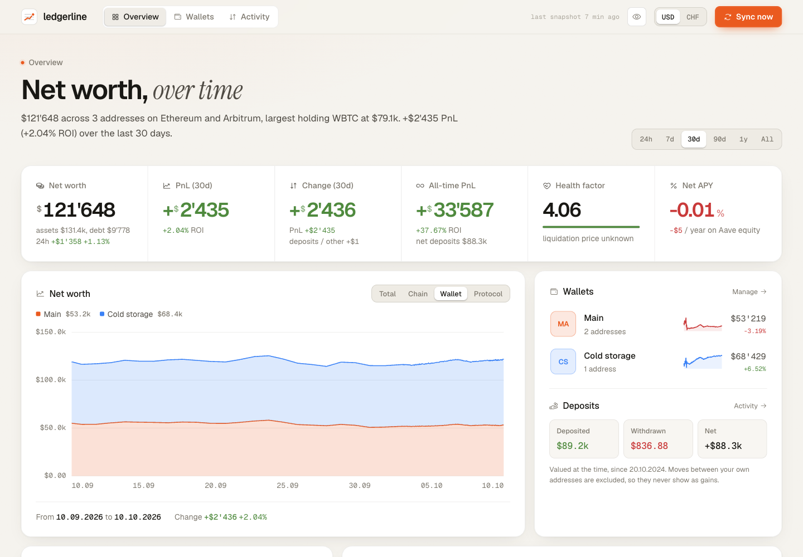
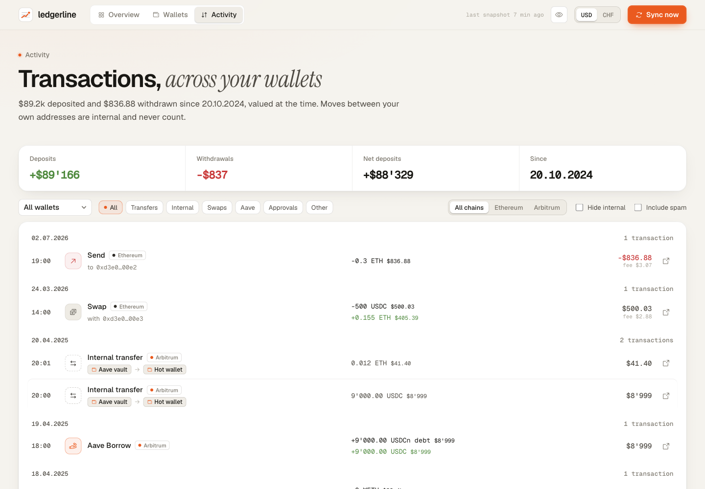
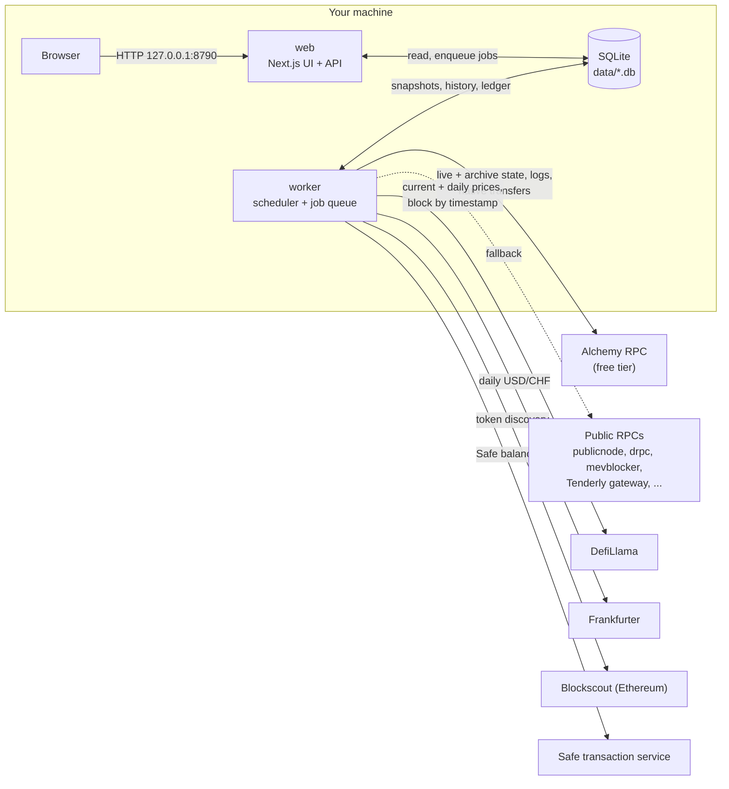

<p align="center">
  <picture>
    <source media="(prefers-color-scheme: dark)" srcset="public/brand/ledgerline-logo-dark.svg">
    <source media="(prefers-color-scheme: light)" srcset="public/brand/ledgerline-logo-light.svg">
    
  </picture>
</p>

<p align="center">
  <strong>A self-hosted, private portfolio tracker for your Ethereum and Arbitrum wallets.</strong><br>
  Wallet tokens and Aave v3 positions, full history from your first transaction, honest PnL, no telemetry.
</p>

<p align="center">
  <a href="https://github.com/sandrich/ledgerline/actions/workflows/ci.yml"></a>
  <a href="LICENSE"></a>
  
</p>

---

ledgerline is a DeBank-style dashboard that runs on your own machine. You give it a few addresses, it
reads balances straight from the chain, builds a daily history back to each address's first activity
and keeps a live snapshot every few minutes. Everything is stored in a single SQLite file that never
leaves your server.

## Screenshots





<sub>Rendered from the synthetic demo database (`npm run demo:data`), not a real portfolio.</sub>

## Contents

- [Features](#features)
- [How it works](#how-it-works)
- [Requirements](#requirements)
- [Alchemy free account](#alchemy-free-account)
- [Quick start](#quick-start)
- [Configuration](#configuration)
- [Self-hosting](#self-hosting)
- [Private access with Tailscale](#private-access-with-tailscale)
- [How the numbers work](#how-the-numbers-work)
- [Limitations](#limitations)
- [Roadmap](#roadmap)
- [Contributing](#contributing)
- [Support](#support)
- [License](#license)

## Features

- **Wallets made of addresses.** Group several addresses into a wallet (for example "Main", "Cold
  storage", "Trading"). An address can sit in more than one wallet; it is scanned once and counted
  once in the overview.
- **Ethereum and Arbitrum.** Native ETH, ERC-20 tokens and Safe smart accounts on both chains.
- **Aave v3, all markets.** Supplied and borrowed assets in every Aave v3 market on these chains:
  Ethereum Core, Prime, EtherFi and Horizon, and Arbitrum.
- **Live snapshots** every N minutes (configurable), with automatic token discovery.
- **Full history.** Daily values backfilled from each address's first on-chain activity, plus hourly
  points for the last 7 days. Gaps are repaired automatically.
- **Honest PnL and ROI.** Profit and loss is computed from what you held and how prices moved, so
  deposits, withdrawals and transfers between your own addresses never show up as gains or losses.
- **Risk and exposure.** Health factor, liquidation price per collateral asset, LTV used, net APY,
  leverage, net exposure per asset (ETH, BTC, USD, ...), stablecoin share and drawdown from the
  all-time high.
- **Activity ledger.** A transaction list that recognises your own wallets: internal transfers, Aave
  supply / withdraw / borrow / repay, swaps, approvals and spam are labelled as such.
- **Stealth mode.** Press `h` (or the eye icon) to mask every amount while percentages stay visible.
  Handy for screenshots and screen sharing.
- **USD or CHF** display, converted with daily FX rates. EUR is on the roadmap.
- **Self-hosted, no telemetry.** No accounts, no analytics, no calls home. The only outbound requests
  go to the data sources listed below.

## How it works

ledgerline is two processes sharing one SQLite database:

- **web**: the Next.js app (UI plus `/api/*` route handlers). It only reads the database and enqueues
  jobs, so it stays fast.
- **worker**: a long-running scheduler that takes snapshots, discovers tokens, backfills history,
  builds the activity ledger, syncs prices and FX, and rolls up old data.



Database migrations are versioned and run automatically when either process starts.

## Requirements

- **Node.js 22 or newer** (or Docker)
- A C/C++ toolchain only if `better-sqlite3` has no prebuilt binary for your platform (rare)
- A **free Alchemy account** (strongly recommended, see below)
- A few tens of MB of disk for a handful of addresses; the database grows slowly after the initial backfill

## Alchemy free account

### Why you need it

ledgerline reads everything directly from the blockchain. Three kinds of requests are hard to get
from free public endpoints:

| What | Used for |
|---|---|
| **Archive state** (`eth_call` at old blocks) | Rebuilding your balances and Aave positions for every past day |
| **`eth_getLogs`** | Finding every token an address ever touched, and the ERC-20 side of the activity ledger |
| **`alchemy_getAssetTransfers`** | Native ETH transfers in the activity ledger (Alchemy-specific, no public equivalent) |

Without a key ledgerline falls back to a pool of public RPC endpoints. It works, but those endpoints
are rate limited, often refuse archive queries and occasionally go away, so backfills are slow and
native ETH transfers are missing from the ledger. With a free Alchemy app everything just works.

### Step by step

1. Sign up at [alchemy.com](https://www.alchemy.com/) (the free plan needs no credit card).
2. In the dashboard, **create an app**. Any name works, for example `ledgerline`.
3. Open the app's **Networks** tab and **enable both Ethereum Mainnet and Arbitrum One**.

   > **Important:** this is the most common pitfall. If Arbitrum is not enabled for the app, every Arbitrum request
   > fails with an error like `ARB_MAINNET is not enabled for this app` and ledgerline silently falls
   > back to the slow public endpoints.

4. Copy the HTTPS endpoint URLs into your `.env`:

   ```dotenv
   ETH_RPC_URL=https://eth-mainnet.g.alchemy.com/v2/<your-api-key>
   ETH_ARCHIVE_RPC_URL=https://eth-mainnet.g.alchemy.com/v2/<your-api-key>
   ARB_RPC_URL=https://arb-mainnet.g.alchemy.com/v2/<your-api-key>
   ARB_ARCHIVE_RPC_URL=https://arb-mainnet.g.alchemy.com/v2/<your-api-key>
   ```

   The same key serves both live and archive requests; the separate variables only exist so you can
   point archive traffic at a different provider if you want to.

5. Restart the worker. Its log shows which endpoint answered each batch of requests.

### Free tier limits and expected usage

| | Free tier | ledgerline |
|---|---|---|
| Monthly budget | 30M compute units (CU) | roughly 1-2M CU per month for 2-3 addresses at a 5 minute snapshot interval |
| Throughput | about 300 CU/s | requests are throttled to about 10 per second per endpoint |
| `eth_getLogs` block range | small on the free plan | handled automatically: wide scans use keyless gateways, the rest is chunked |
| Backfill of a new address | | a few minutes for a typical address |

The default snapshot interval is 15 minutes, which uses even less. You can keep a lot of headroom and
still run snapshots every 5 minutes.

## Quick start

### Try the UI with demo data (no keys needed)

```bash
git clone https://github.com/sandrich/ledgerline.git
cd ledgerline
npm ci
npm run demo:data                         # writes a synthetic database to ./data/demo.db
DATABASE_PATH=./data/demo.db npm run dev  # http://127.0.0.1:8790
```

The demo database contains made-up wallets and positions. Do not start the worker against it.

### Track your own addresses

```bash
npm ci
cp .env.example .env      # then add your Alchemy URLs
npm run dev               # web on http://127.0.0.1:8790
npm run worker            # scheduler, in a second terminal
```

Open http://127.0.0.1:8790, go to **Wallets**, create a wallet and add one or more addresses. The
worker picks them up within seconds, takes a first snapshot and starts the history backfill. Progress
is shown in the UI.

## Configuration

All settings come from environment variables, usually via `.env` (see [`.env.example`](.env.example)).
Every variable is optional.

| Variable | Default | Description |
|---|---|---|
| `PORT` | `8790` | Web port |
| `HOST` | `127.0.0.1` | Web bind address. Keep it on loopback unless you know why not |
| `DATABASE_PATH` | `./data/portfolio.db` | SQLite file shared by web and worker (inside Docker: `/app/data/portfolio.db`) |
| `ETH_RPC_URL` | public pool | Ethereum endpoint for live state (Alchemy recommended) |
| `ETH_ARCHIVE_RPC_URL` | public pool | Ethereum endpoint for historical state |
| `ARB_RPC_URL` | public pool | Arbitrum endpoint for live state (Alchemy recommended) |
| `ARB_ARCHIVE_RPC_URL` | public pool | Arbitrum endpoint for historical state. Strongly recommended if an address was active before the Nitro upgrade (2022-09) |
| `SNAPSHOT_INTERVAL_MINUTES` | `15` | Live snapshot cadence. 5 works well on the free tier |
| `DISCOVERY_INTERVAL_MINUTES` | `60` | New token discovery |
| `PRICE_HISTORY_INTERVAL_HOURS` | `6` | Daily price and FX sync |
| `RETENTION_RAW_DAYS` | `30` | Keep raw snapshots this long, then roll up to hourly |
| `RETENTION_HOURLY_DAYS` | `365` | Keep hourly points this long; daily points are kept forever |
| `HOURLY_BACKFILL_HOURS` | `168` | Hours of hourly history to backfill (7 days) |
| `HOURLY_BACKFILL_INTERVAL_HOURS` | `6` | How often to check for missing hours |
| `LOG_LEVEL` | `info` | `debug`, `info`, `warn` or `error` |

<details>
<summary>Advanced settings</summary>

| Variable | Default | Description |
|---|---|---|
| `LEDGER_INTERVAL_MINUTES` | same as discovery | Activity ledger refresh |
| `BACKFILL_INTERVAL_HOURS` | `6` | Re-run the (resumable) daily backfill to pick up missed days |
| `ROLLUP_INTERVAL_MINUTES` | `60` | Raw to hourly rollup and retention |
| `WORKER_POLL_SECONDS` | `5` | How often the worker checks the job queue |
| `WORKER_SHUTDOWN_TIMEOUT_SECONDS` | `20` | Grace period for running jobs on SIGTERM |
| `JOBS_RETENTION_DAYS` | `7` | Finished jobs are pruned after this |
| `LOG_FORMAT` | auto | `json` or `text`. Defaults to JSON lines when stdout is not a TTY |

</details>

## Self-hosting

ledgerline has no authentication. It is meant to listen on `127.0.0.1` and be reached through
something you trust, such as [Tailscale](#private-access-with-tailscale) or an SSH tunnel.

### Docker Compose (recommended)

```bash
git clone https://github.com/sandrich/ledgerline.git
cd ledgerline
cp .env.example .env      # add your Alchemy URLs
docker compose up -d --build
```

This starts the web and worker services. The web port is published on
`127.0.0.1:8790` only, and the database persists in the mounted `./data` volume (see
[`docker-compose.yml`](docker-compose.yml)).

```bash
docker compose logs -f worker     # watch snapshots and backfills
docker compose ps                 # both services should be running
```

### Plain Node

```bash
npm ci
npm run build
npm run start     # web on 127.0.0.1:8790
npm run worker    # in a second process
```

Both processes need the same working directory and `.env`.

### systemd

Two units, one per process. Replace `<user>` and `/opt/ledgerline` with your own values.

<details>
<summary><code>/etc/systemd/system/ledgerline-web.service</code></summary>

```ini
[Unit]
Description=ledgerline web
After=network-online.target
Wants=network-online.target

[Service]
Type=simple
User=<user>
WorkingDirectory=/opt/ledgerline
Environment=NODE_ENV=production
ExecStart=/usr/bin/npm run start
Restart=on-failure
RestartSec=5

# Hardening
NoNewPrivileges=true
PrivateTmp=true
ProtectSystem=strict
ProtectHome=true
ReadWritePaths=/opt/ledgerline/data /opt/ledgerline/.next
ProtectKernelTunables=true
ProtectKernelModules=true
ProtectControlGroups=true
RestrictSUIDSGID=true
LockPersonality=true

[Install]
WantedBy=multi-user.target
```

</details>

<details>
<summary><code>/etc/systemd/system/ledgerline-worker.service</code></summary>

```ini
[Unit]
Description=ledgerline worker
After=network-online.target
Wants=network-online.target

[Service]
Type=simple
User=<user>
WorkingDirectory=/opt/ledgerline
Environment=NODE_ENV=production
ExecStart=/usr/bin/npm run worker
Restart=on-failure
RestartSec=5
TimeoutStopSec=30

# Hardening
NoNewPrivileges=true
PrivateTmp=true
ProtectSystem=strict
ProtectHome=true
ReadWritePaths=/opt/ledgerline/data
ProtectKernelTunables=true
ProtectKernelModules=true
ProtectControlGroups=true
RestrictSUIDSGID=true
LockPersonality=true

[Install]
WantedBy=multi-user.target
```

</details>

```bash
sudo systemctl daemon-reload
sudo systemctl enable --now ledgerline-web ledgerline-worker
journalctl -u ledgerline-worker -f
curl -s http://127.0.0.1:8790/api/health
```

If the app lives under a home directory, use `ProtectHome=read-only` instead of `true`. Make sure
`.env` is readable only by the service user (`chmod 600 .env`).

### Backups

The database runs in WAL mode, so do not just copy the file while the worker is writing. Use SQLite's
online backup instead:

```bash
sqlite3 data/portfolio.db ".backup 'data/backup-$(date +%F).db'"
```

Or, without the `sqlite3` CLI, from the app directory:

```bash
node -e "new (require('better-sqlite3'))(process.argv[1]).backup(process.argv[2]).then(() => console.log('ok'))" data/portfolio.db data/backup.db
```

Everything except prices can be rebuilt from the chain, but a full re-backfill takes time and RPC
budget, so a daily backup is cheap insurance.

### Upgrading

```bash
git pull
npm ci && npm run build      # or: docker compose up -d --build
# then restart web and worker
```

Database migrations run automatically on startup. Take a backup first if you want to be able to roll
back.

## Private access with Tailscale

Your dashboard shows your holdings, so it should never be on the public internet. The simplest way to
reach it from your phone and laptop is [Tailscale](https://tailscale.com/): keep ledgerline bound to
`127.0.0.1` and let Tailscale publish it only inside your tailnet, with HTTPS.

### Simple: `tailscale serve`

On the host running ledgerline:

```bash
tailscale serve --bg 8790
```

The app is now available at `https://<machine-name>.<your-tailnet>.ts.net` to devices in your tailnet,
with a certificate managed by Tailscale. `tailscale serve status` shows the mapping and
`tailscale serve --https=443 off` removes it.

### Tailscale Services (its own hostname)

[Tailscale Services](https://tailscale.com/kb/1552/tailscale-services) give the app a stable name that
is independent of the machine it runs on.

1. In the admin console, open **Services** and define a service, for example `svc:ledgerline`, with
   port `tcp:443`.
2. On the host, advertise it:

   ```bash
   tailscale serve --service=svc:ledgerline --https=443 http://127.0.0.1:8790
   ```

3. Approve the host for that service in the admin console (unless auto-approval is configured).
4. Add an access grant to your tailnet policy so your devices can reach the service, for example:

   ```json
   {
     "grants": [
       { "src": ["autogroup:member"], "dst": ["svc:ledgerline"], "ip": ["tcp:443"] }
     ]
   }
   ```

The app is then reachable at `https://ledgerline.<your-tailnet>.ts.net`.

> [!CAUTION]
> Never use **Tailscale Funnel** for ledgerline. Funnel exposes the app to the whole internet, and
> ledgerline has no login: anyone with the URL would see your wallets and balances.

## How the numbers work

- **Net worth** is wallet tokens plus supplied assets minus borrowed assets, valued at current prices.
- **PnL** is holdings-based. For every pair of consecutive history points it takes the amount of each
  token you held at the earlier point and multiplies it by the price change until the later point,
  per address, chain and token. Debt counts negative, and Aave aTokens are priced as their underlying.
  Moving funds between your own addresses therefore never creates profit or loss, and neither does
  depositing new money.
- **ROI** is PnL divided by the capital at work in the window: the starting value plus the peak of
  cumulative net deposits during the window. With no deposits it is simply PnL divided by the starting
  value.
- **Other** is everything in the value change that is not price PnL: deposits and withdrawals, Aave
  interest earned and paid, and gas fees (`Other = change in net worth - PnL`).
- **Currency.** All values are stored in USD. CHF figures use the daily USD/CHF rate of the day each
  point belongs to, so historical charts are not distorted by today's rate.

## Limitations

- **Chains:** Ethereum and Arbitrum only.
- **Protocols:** Aave v3 is the only protocol for now. Tokens held in other protocols appear only if
  they sit in your wallet as a token (for example LP or vault tokens with a known price).
- **Native ETH on Arbitrum:** ETH paid out to you by a contract (an internal call) is not visible in
  the activity ledger, because Alchemy does not support internal transfers on Arbitrum. Balances and
  PnL are still correct.
- **Prices:** prices come from DefiLlama. Long-tail tokens without DefiLlama coverage are shown
  without a value, and history points where a held token had no price are marked as partial.
- **No authentication:** see [Self-hosting](#self-hosting).

## Roadmap

- EUR as a display currency
- Split "Other" into interest earned, interest paid and gas
- Currency effect (how much of a CHF/EUR change comes from FX)
- More chains (Base, Optimism, ...) and protocols

Ideas and pull requests are welcome, see below.

## Contributing

Contributions of all sizes are welcome: bug reports, docs, new chains or protocols. Read
[CONTRIBUTING.md](CONTRIBUTING.md) to get started, and please follow the
[Code of Conduct](CODE_OF_CONDUCT.md). Security issues go through [SECURITY.md](SECURITY.md), not
public issues. Coding agents should read [AGENTS.md](AGENTS.md).

## Support

<!-- Donation links will be added here once they are available. -->

If ledgerline is useful to you, a star on GitHub helps others find it.

## License

[MIT](LICENSE) © 2026 Chris Sandrini
